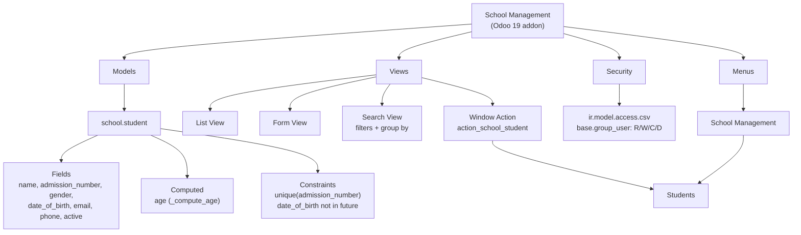
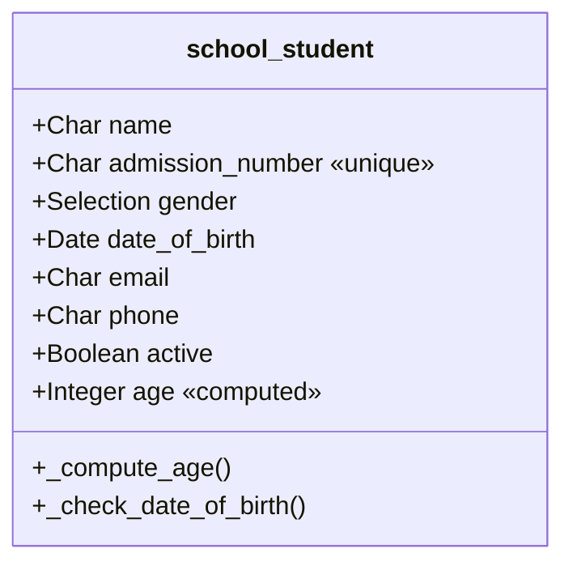
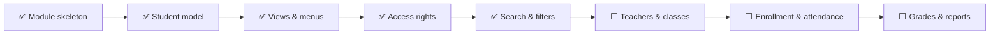

# 🎓 School Management — Odoo 19


A standalone **Odoo 19** module to manage students and basic school operations.
This repository contains **only** the `school_management` module.

---

## 📌 Overview

The module adds a **School Management** application to Odoo with a complete
student registry: registration, personal information, contact details, age
computation, archiving, searching and filtering.

| Feature | Description |
| --- | --- |
| Student registration | Create, edit and archive student records |
| Unique admission number | Database-level `unique` constraint per student |
| Auto-computed age | Derived from date of birth, always up to date |
| Date validation | Future dates of birth are rejected |
| Search & filters | Search by name / admission no. / email, filter active & archived, group by gender |
| Multi-user access | Access rights defined for internal users |

---

## 🧩 Module Architecture



---

## 🗃️ Data Model



**Constraints**

- `admission_number` must be unique across all students (DB constraint).
- `date_of_birth` cannot be a future date (`ValidationError`).
- `age` is computed on the fly from `date_of_birth` (not stored), so it always
  reflects the student's current age.

---

## 📂 Project Structure

```text
school_management/
├── __init__.py
├── __manifest__.py
├── models/
│   ├── __init__.py
│   └── student.py
├── security/
│   └── ir.model.access.csv
├── views/
│   └── student_views.xml
├── .gitignore
└── README.md
```

---

## ⚙️ Installation

1. Copy the `school_management` folder into your Odoo **addons** path, e.g.:

   ```bash
   git clone https://github.com/Ahmed-Samy-Omran/school_management.git
   ```

2. Restart the Odoo server.
3. In Odoo: **Apps → Update Apps List**.
4. Search for **School Management System** and click **Install**.

> Requires Odoo **19.0** and Python **3.10+**.

---

## 🚀 Usage

1. Open the **School Management** app from the main menu.
2. Go to **Students → New**.
3. Fill in the student name and admission number (required).
4. Add date of birth — the **age** field is calculated automatically.
5. Use the search bar to find students, filter **Active / Archived**, or
   **group by gender**.

---

## 🗺️ Roadmap



- [x] Module skeleton & manifest
- [x] Student model with computed age and constraints
- [x] List / form / search views and menus
- [x] Security access rights
- [x] Search filters and grouping
- [ ] Teachers & classes
- [ ] Enrollment & attendance
- [ ] Grades & reports

---

## 🤝 Contributing

Pull requests are welcome. For major changes, please open an issue first to
discuss what you would like to change.

```bash
git checkout -b feature/my-feature
git commit -m "Add my feature"
git push origin feature/my-feature
```

---

## 📄 License

This project is licensed under **LGPL-3**.

## 👤 Author

**Ahmed Omran** — [@Ahmed-Samy-Omran](https://github.com/Ahmed-Samy-Omran)
