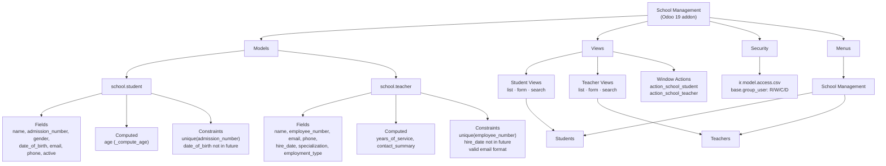
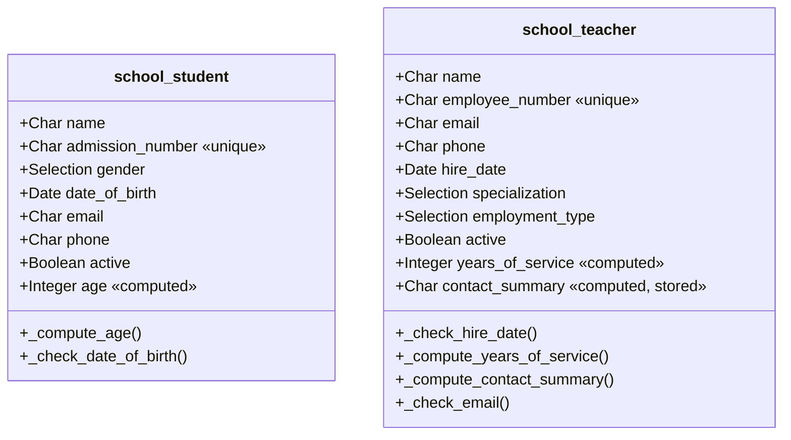
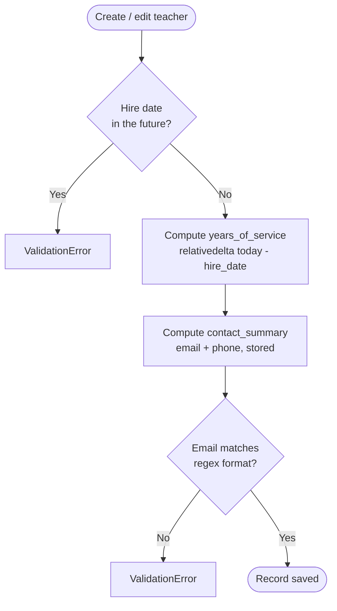
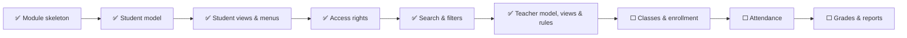

# 🎓 School Management — Odoo 19


A standalone **Odoo 19** module to manage students, teachers and basic school
operations. This repository contains **only** the `school_management` module.

---

## 📌 Overview

The module adds a **School Management** application to Odoo with two registries:

- **Students** — registration, personal data, computed age and archiving.
- **Teachers** — employment data, specialization, computed years of service,
  contact summary and email validation.

| Feature | Description |
| --- | --- |
| Student registration | Create, edit and archive student records |
| Teacher registration | Create, edit and archive teacher records |
| Unique identifiers | `unique(admission_number)` and `unique(employee_number)` at DB level |
| Auto-computed age | Derived from the student's date of birth, always up to date |
| Auto-computed years of service | Derived from the teacher's hire date |
| Contact summary | Teacher email/phone summarized in one stored field |
| Validations | Future dates and invalid emails are rejected |
| Search & filters | Name / number / email search, active-archived filters, grouping |
| Multi-user access | Access rights defined for internal users |

---

## 🧩 Module Architecture



---

## 🗃️ Data Model



### `school.teacher` fields

| Field | Type | Notes |
| --- | --- | --- |
| `name` | Char | Required, indexed |
| `employee_number` | Char | Required, unique, not copied |
| `email` / `phone` | Char | Optional contact data |
| `contact_summary` | Char | Computed & stored from email/phone |
| `hire_date` | Date | Required, defaults to today, cannot be in the future |
| `specialization` | Selection | Mathematics, Science, English, Arabic, History, Geography, Computer Science, Other |
| `employment_type` | Selection | Full Time, Part Time, Contract |
| `years_of_service` | Integer | Computed from `hire_date` (not stored) |
| `active` | Boolean | Enables archive/unarchive |

### Business rules



**Constraints**

- `school.student.admission_number` must be unique (DB constraint).
- `school.teacher.employee_number` must be unique (DB constraint).
- `date_of_birth` and `hire_date` cannot be future dates (`ValidationError`).
- Teacher `email`, when filled, must match a valid email pattern.
- `age` and `years_of_service` are computed on the fly, so they stay accurate
  over time.

---

## 📂 Project Structure

```text
school_management/
├── __init__.py
├── __manifest__.py
├── LICENSE
├── models/
│   ├── __init__.py
│   ├── student.py
│   └── teacher.py
├── security/
│   └── ir.model.access.csv
├── views/
│   ├── student_views.xml
│   └── teacher_views.xml
├── .gitignore
└── README.md
```

---

## ⚙️ Installation

1. Clone the module into your Odoo **addons** path:

   ```bash
   git clone https://github.com/Ahmed-Samy-Omran/school_management.git
   ```

2. Restart the Odoo server.
3. In Odoo: **Apps → Update Apps List**.
4. Search for **School Management System** and click **Install**.

> Requires Odoo **19.0**.

---

## 🚀 Usage

1. Open the **School Management** app from the main menu.
2. **Students → New**: fill the name and admission number (required), add the
   date of birth and the age is computed automatically.
3. **Teachers → New**: fill the name, employee number, hire date,
   specialization and employment type — years of service and contact summary
   are computed for you.
4. Use the search bar to filter **Active / Archived**, filter by employment
   type or specialization, and group by gender / specialization.

---

## 🗺️ Roadmap



- [x] Module skeleton & manifest
- [x] Student model with computed age and constraints
- [x] Student list / form / search views and menus
- [x] Security access rights
- [x] Search filters and grouping
- [x] Teacher model: unique employee number, computed service years, contact summary, email validation
- [x] Teacher list / form / search views, action and menu
- [ ] Classes & enrollment
- [ ] Attendance
- [ ] Grades & reports

---

## 🤝 Contributing

Pull requests are welcome. For major changes, please open an issue first to
discuss what you would like to change.

```bash
git checkout -b feature/my-feature
git commit -m "Add my feature"
git push origin feature/my-feature
```

---

## 📄 License

This project is licensed under **LGPL-3** — see the [LICENSE](LICENSE) file.

## 👤 Author

**Ahmed Omran** — [@Ahmed-Samy-Omran](https://github.com/Ahmed-Samy-Omran)
