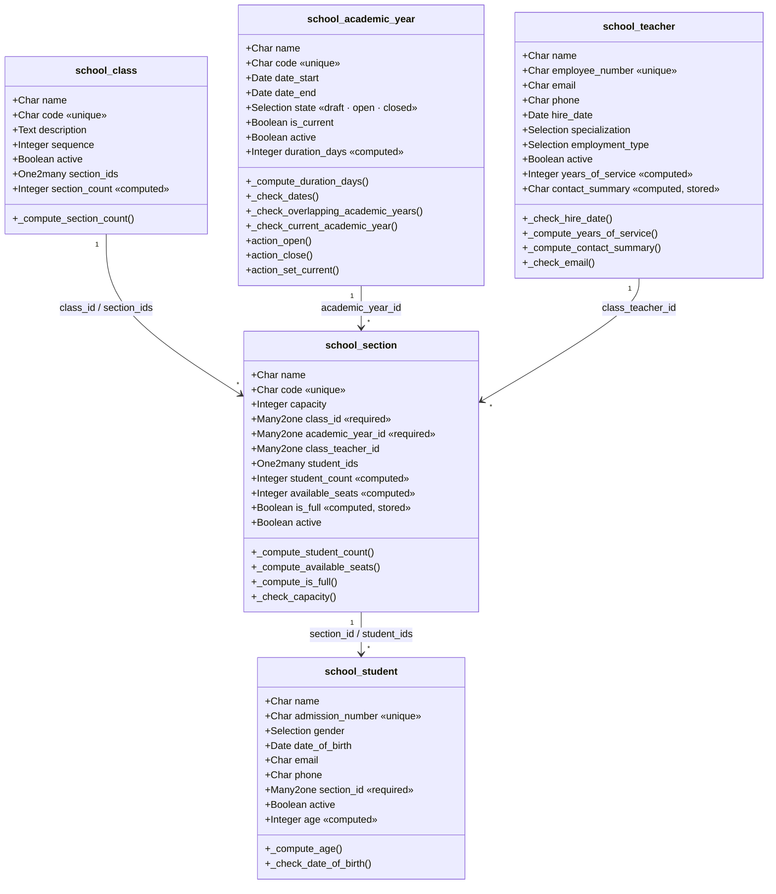
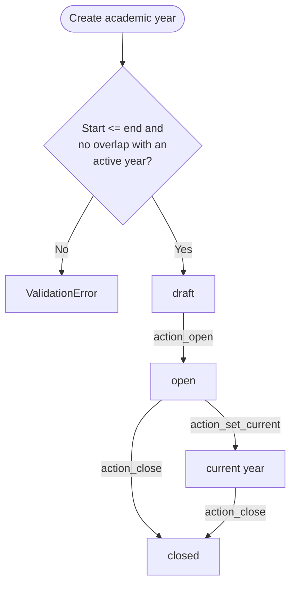
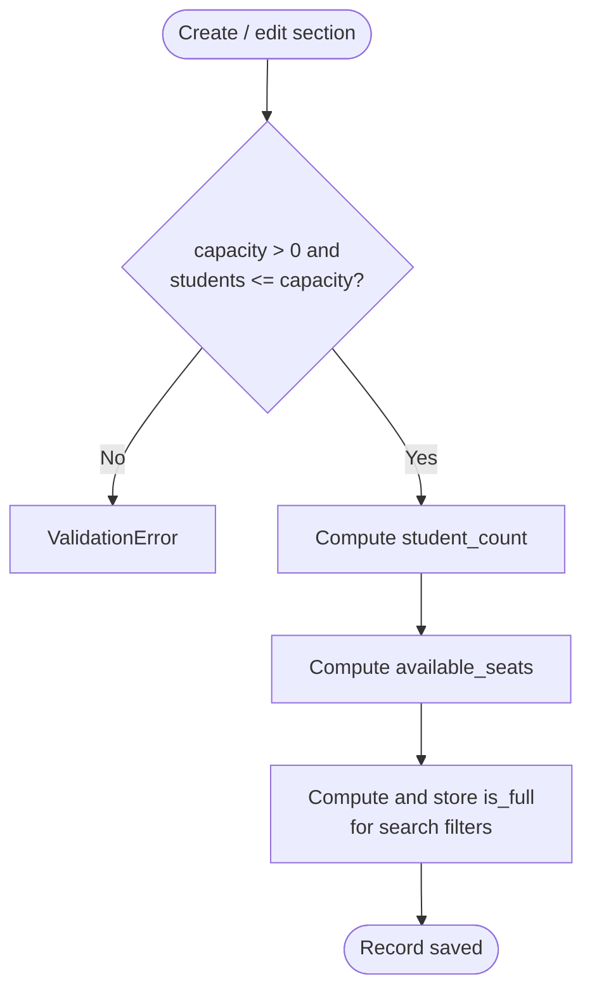

# 🎓 School Management — Odoo 19


A standalone **Odoo 19** module to manage students, teachers, academic years,
classes (grades), sections and enrollment. This repository contains **only** the
`school_management` module.

---

## 📌 Overview

The module adds a **School Management** application to Odoo with five
registries:

- **Students** — registration, personal data, computed age, section assignment
  and archiving.
- **Teachers** — employment data, specialization, computed years of service,
  contact summary, email validation and section assignments.
- **Academic Years** — dated school years, computed duration, open/close
  lifecycle and a single current year.
- **Classes (Grades)** — ordered registry with a unique code and its sections.
- **Sections** — class + academic year + optional class teacher, capacity,
  enrolled students, available seats and full/not-full state.

| Feature | Description |
| --- | --- |
| Student registration | Create, edit and archive student records, assigned to a section |
| Teacher registration | Create, edit and archive teacher records |
| Academic year management | Create school years, track duration and lifecycle state |
| Class (grade) management | Create grades with a unique code, ordering and section list |
| Section management | Create sections linked to a grade, academic year and class teacher |
| Enrollment | Students belong to a section; capacity and available seats are enforced |
| Unique identifiers | `unique(admission_number)`, `unique(employee_number)` and `unique(code)` on years, classes and sections at DB level |
| Auto-computed age | Derived from the student's date of birth, always up to date |
| Auto-computed years of service | Derived from the teacher's hire date |
| Auto-computed duration | Academic year length in days, derived from its start/end dates |
| Auto-computed counts and seats | Section student count, available seats and class section count |
| Stored full state | `is_full` is stored so search filters can use it in domains |
| Contact summary | Teacher email/phone summarized in one stored field |
| Validations | Future dates, invalid emails, invalid periods, overlapping active years and invalid section capacity are rejected |
| Current year rule | Only one active academic year can be marked as current |
| Search & filters | Name / number / email / code search, active/full filters and grouping by class, year or teacher |
| Multi-user access | Access rights defined for internal users |

---

## 🧩 Module Architecture

```mermaid
flowchart TD
    A["School Management<br/>(Odoo 19 addon)"] --> B["Models"]
    A --> C["Views"]
    A --> D["Security"]
    A --> E["Menus"]

    B --> B1["school.student"]
    B1 --> B1a["Fields<br/>name, admission_number, gender,<br/>date_of_birth, email, phone,<br/>section_id «required», active"]
    B1 --> B1b["Computed<br/>age (_compute_age)"]
    B1 --> B1c["Constraints<br/>unique(admission_number)<br/>date_of_birth not in future"]

    B --> B2["school.teacher"]
    B2 --> B2a["Fields<br/>name, employee_number, email, phone,<br/>hire_date, specialization, employment_type"]
    B2 --> B2b["Computed<br/>years_of_service, contact_summary «stored»"]
    B2 --> B2c["Constraints<br/>unique(employee_number)<br/>hire_date not in future<br/>valid email format"]

    B --> B3["school.academic_year"]
    B3 --> B3a["Fields<br/>name, code, date_start, date_end,<br/>state, is_current, active"]
    B3 --> B3b["Computed<br/>duration_days (not stored)"]
    B3 --> B3c["Constraints<br/>unique(code)<br/>date_start <= date_end<br/>no overlapping active years<br/>one current year"]
    B3 --> B3d["Actions<br/>action_open · action_close<br/>action_set_current"]

    B --> B4["school.class"]
    B4 --> B4a["Fields<br/>name, code, description,<br/>sequence, active"]
    B4 --> B4b["Computed<br/>section_count<br/>(_compute_section_count)"]
    B4 --> B4c["Constraints<br/>unique(code)"]

    B --> B5["school.section"]
    B5 --> B5a["Fields<br/>name, code, capacity, class_id,<br/>academic_year_id, class_teacher_id,<br/>student_ids, active"]
    B5 --> B5b["Computed<br/>student_count, available_seats<br/>is_full «stored»"]
    B5 --> B5c["Constraints<br/>unique(code)<br/>capacity > 0<br/>students <= capacity"]

    C --> C1["Student Views<br/>list · form · search"]
    C --> C2["Teacher Views<br/>list · form · search"]
    C --> C3["Academic Year Views<br/>list · form · search"]
    C --> C4["Class Views<br/>list · form · search"]
    C --> C5["Section Views<br/>list · form · search"]
    C --> C6["Window Actions<br/>action_school_student<br/>action_school_teacher<br/>action_academic_year<br/>action_school_class<br/>action_school_section"]

    D --> D1["ir.model.access.csv<br/>base.group_user: R/W/C/D"]

    E --> E1["School Management"]
    E1 --> E2["Students"]
    E1 --> E3["Teachers"]
    E1 --> E4["Academic Years"]
    E1 --> E5["Grades"]
    E1 --> E6["Sections"]

    C1 --> E2
    C2 --> E3
    C3 --> E4
    C4 --> E5
    C5 --> E6
```



---

## 🗃️ Data Model



### `school.student` fields

| Field | Type | Notes |
| --- | --- | --- |
| `name` | Char | Required, indexed |
| `admission_number` | Char | Required, unique, not copied |
| `gender` | Selection | Male / Female |
| `date_of_birth` | Date | Cannot be in the future |
| `email` / `phone` | Char | Optional contact data |
| `section_id` | Many2one | Required section (`school.section`), restrict on delete |
| `age` | Integer | Computed from `date_of_birth` (not stored) |
| `active` | Boolean | Enables archive/unarchive |

### `school.teacher` fields

| Field | Type | Notes |
| --- | --- | --- |
| `name` | Char | Required, indexed |
| `employee_number` | Char | Required, unique, not copied |
| `email` / `phone` | Char | Optional contact data |
| `contact_summary` | Char | Computed & stored from email/phone |
| `hire_date` | Date | Required, defaults to today, cannot be in the future |
| `specialization` | Selection | Mathematics, Science, English, Arabic, History, Geography, Computer Science, Other |
| `employment_type` | Selection | Full Time, Part Time, Contract |
| `years_of_service` | Integer | Computed from `hire_date` (not stored) |
| `active` | Boolean | Enables archive/unarchive |

### `school.academic_year` fields

| Field | Type | Notes |
| --- | --- | --- |
| `name` | Char | Required, indexed |
| `code` | Char | Required, unique, indexed, not copied |
| `date_start` / `date_end` | Date | Required; end must be on or after start |
| `duration_days` | Integer | Computed from `date_start`/`date_end` (inclusive), not stored |
| `state` | Selection | `draft` → `open` → `closed`; required, indexed |
| `is_current` | Boolean | Only one active, open year can be current |
| `active` | Boolean | Enables archive/unarchive |

### `school.class` fields

| Field | Type | Notes |
| --- | --- | --- |
| `name` | Char | Required, indexed |
| `code` | Char | Required, unique, indexed, not copied |
| `description` | Text | Optional notes about the grade |
| `sequence` | Integer | Ordering, defaults to 10 |
| `section_ids` | One2many | Sections belonging to the grade |
| `section_count` | Integer | Computed from `section_ids` (not stored) |
| `active` | Boolean | Enables archive/unarchive |

### `school.section` fields

| Field | Type | Notes |
| --- | --- | --- |
| `name` | Char | Required, indexed |
| `code` | Char | Required, unique, indexed, not copied |
| `capacity` | Integer | Required, defaults to 30, must be greater than zero |
| `class_id` | Many2one | Required grade (`school.class`), restrict on delete |
| `academic_year_id` | Many2one | Required academic year, restrict on delete |
| `class_teacher_id` | Many2one | Optional teacher (`school.teacher`), restrict on delete |
| `student_ids` | One2many | Enrolled students (`school.student`) |
| `student_count` | Integer | Computed from `student_ids` (not stored) |
| `available_seats` | Integer | Computed from `capacity` and `student_ids` (not stored) |
| `is_full` | Boolean | Computed and **stored**, so it can be used in search domains |
| `active` | Boolean | Enables archive/unarchive |

### Academic year lifecycle



**Constraints**

- Academic year `code` must be unique (DB constraint).
- `date_end` must be greater than or equal to `date_start` (`ValidationError`).
- Active academic years may not overlap (`ValidationError`).
- The current academic year must be active and in the `open` state, and only one
  year can be current at a time (`ValidationError`).
- A closed academic year cannot be reopened; closing it clears `is_current`.
- `duration_days` is recomputed on access from the dates (not stored).

### Class and section rules



**Constraints**

- `school.class.code` and `school.section.code` must be unique (DB constraint).
- Section capacity must be greater than zero and cannot be lower than the number
  of enrolled students (`ValidationError`).
- A section requires a class and an academic year; a student requires a section.
  Deleting a referenced record is restricted.
- `section_count`, `student_count` and `available_seats` are computed on the fly;
  `is_full` is stored so the **Full Sections** / **Sections With Seats** search
  filters can use it in their domains.

### Business rules


**Constraints**

- `school.student.admission_number`, `school.teacher.employee_number`,
  `school.academic_year.code`, `school.class.code` and `school.section.code`
  must be unique (DB constraint).
- `date_of_birth` and `hire_date` cannot be future dates (`ValidationError`).
- Teacher `email`, when filled, must match a valid email pattern.
- Academic years require a valid period and cannot overlap when active
  (`ValidationError`).
- Only one active, open academic year can be current (`ValidationError`).
- `age`, `years_of_service`, `duration_days`, `section_count`, `student_count`
  and `available_seats` are computed on the fly; `contact_summary` and `is_full`
  are computed and stored.

---

## 📂 Project Structure

```text
school_management/
├── __init__.py
├── __manifest__.py
├── LICENSE
├── models/
│   ├── __init__.py
│   ├── student.py
│   ├── teacher.py
│   ├── academic_year.py
│   ├── school_class.py
│   └── section.py
├── security/
│   └── ir.model.access.csv
├── views/
│   ├── student_views.xml
│   ├── teacher_views.xml
│   ├── academic_year_views.xml
│   ├── school_class_views.xml
│   └── school_section_views.xml
├── .gitignore
└── README.md
```

---

## ⚙️ Installation

1. Clone the module into your Odoo **addons** path:

   ```bash
   git clone https://github.com/Ahmed-Samy-Omran/school_management.git
   ```

2. Restart the Odoo server.
3. In Odoo: **Apps → Update Apps List**.
4. Search for **School Management System** and click **Install**.
5. If the module is already installed, click **Upgrade** instead to load new
   models, views and menus. Version `19.0.1.2.0` adds the class and section
   models, so an upgrade is required on existing databases.

> Requires Odoo **19.0**.

---

## 🚀 Usage

1. Open the **School Management** app from the main menu.
2. **Students → New**: fill the name, admission number and (required) section;
   the age is computed automatically.
3. **Teachers → New**: fill the name, employee number, hire date,
   specialization and employment type — years of service and contact summary
   are computed for you.
4. **Academic Years → New**: fill the name, a unique code and the start/end
   dates; the duration in days is computed automatically. Use **Open** to move
   the year from draft to open, **Set as Current** to make it the active year
   and **Close** to finish it.
5. **Grades → New**: fill the name and unique code; optionally set the sequence
   and description. The **Sections** tab lists the grade's sections.
6. **Sections → New**: fill the name, unique code, grade and academic year;
   optionally choose a class teacher and set the capacity. Student count,
   available seats and full state are computed automatically.
7. Use the search bar to filter **Active / Archived** and **Full Sections /
   Sections With Seats**, filter academic years by state or current year,
   filter teachers by employment type or specialization, and group by grade,
   academic year, class teacher, gender or specialization.

---

## 🗺️ Roadmap

```mermaid
graph LR
    A["✅ Module skeleton"] --> B["✅ Student model"]
    B --> C["✅ Student views & menus"]
    C --> D["✅ Access rights"]
    D --> E["✅ Search & filters"]
    E --> F["✅ Teacher model, views & rules"]
    F --> F2["✅ Academic year model, views & rules"]
    F2 --> G["✅ Classes, sections & enrollment"]
    G --> H["⬜ Attendance"]
    H --> I["⬜ Grades & reports"]
```



- [x] Module skeleton & manifest
- [x] Student model with computed age and constraints
- [x] Student list / form / search views and menus
- [x] Security access rights
- [x] Search filters and grouping
- [x] Teacher model: unique employee number, computed service years, contact summary, email validation
- [x] Teacher list / form / search views, action and menu
- [x] Academic year model: unique code, computed duration, period/overlap/current-year validation and lifecycle actions
- [x] Academic year list / form / search views, action and menu
- [x] Class (grade) model: unique code, ordering and computed section count
- [x] Section model: class/year/teacher links, capacity rules, computed seats and stored full state
- [x] Class and section list / form / search views, actions and menus
- [x] Enrollment: students assigned to sections with capacity enforcement
- [ ] Attendance
- [ ] Grades & reports

---

## 🤝 Contributing

Pull requests are welcome. For major changes, please open an issue first to
discuss what you would like to change.

```bash
git checkout -b feature/my-feature
git commit -m "Add my feature"
git push origin feature/my-feature
```

---

## 📄 License

This project is licensed under **LGPL-3** — see the [LICENSE](LICENSE) file.

## 👤 Author

**Ahmed Omran** — [@Ahmed-Samy-Omran](https://github.com/Ahmed-Samy-Omran)
